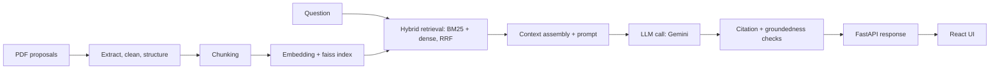

# SDG Align

A RAG + agent pipeline that analyses GEF/UNDP project proposals against the UN Sustainable Development Goals: it answers questions about proposals with citations, and abstains when the documents do not contain the answer.

## What it does

- Runs a 22-stage pipeline (stages 0-21): PDF ingestion, chunking, embedding, indexing, retrieval, prompt building, LLM call, citation and groundedness checks, caching, and an agent layer.
- Retrieves with hybrid search: BM25 plus dense vectors, fused by reciprocal rank fusion.
- Returns answers with citations to source chunks.
- Abstains on questions the documents cannot answer: the model replies exactly `NOT_IN_CONTEXT`.
- Serves the pipeline through a FastAPI backend and a React frontend. The backend also runs on Cloud Run (IAM-only access).

The SDG-target alignment product described in [`docs/ARCHITECTURE_BLUEPRINT.md`](docs/ARCHITECTURE_BLUEPRINT.md) (target extraction, evidence validator, gap analysis) is not built. What exists is the question-answering pipeline it would sit on.

## Results

All numbers come from a frozen 66-item gold set over 6 documents. Tuning used the DEV split; the TEST split (52 items: 44 answerable, 8 unanswerable) was scored once per configuration.

| Result | Value | Evidence |
|---|---|---|
| Retrieval Recall@5, dense vs hybrid | 0.57 vs 0.77 (paired gain 95% CI +0.09 to +0.32, exact McNemar p = 0.004, n = 44) | [`reports/PHASE_2_REPORT.md`](reports/PHASE_2_REPORT.md), `eval/results/phase2_ladder.md` |
| Cloud Run retrieval vs offline retrieval | Identical on all 66 gold items (Recall@5 0.7727 TEST, 0.8333 DEV; 0 LLM calls) | `eval/results/step7_served_vs_offline.json` |
| Answer correctness, 44 answerable TEST items | 31 correct (70.5%, 95% CI 55.8-81.8%), 37 correct or partial, 6 refused, 1 wrong out of 38 answered | `eval/results/test_v21_correctness_summary.json`, `eval/test_v21_correctness_final.json` |
| Abstention, unanswerable items | 8/8 refused (n = 8, so the interval is wide) | `eval/results/test_noplanner_v21_summary.json` |
| False refusals on answerable items | 6/44 (13.6%). The pre-registered target of 4/44 or fewer was **not met** | `eval/results/test_noplanner_v21_summary.json`, [`reports/PHASE_3_REPORT.md`](reports/PHASE_3_REPORT.md) |
| Planner vs no planner | No change in refusals (6/44 both); 2.96 vs 1 LLM calls per request. The planner is off by default | `eval/results/step5_arms.json`, [`reports/PHASE_3_STEP5_REPORT.md`](reports/PHASE_3_STEP5_REPORT.md) |
| Tests | 1037 tests, 87% coverage of `scripts/`. The mutation probe runs a no-op control first and aborts if the control is not caught | [`reports/PHASE_3_5_REPORT.md`](reports/PHASE_3_5_REPORT.md), `tools/mutation_probe.py` |

Correctness labels are AI-produced, not human-verified. Two blind labelling runs by the same model family agreed on 43 of 44 items (kappa 0.95). I adjudicated the one disagreement (Q036: partial). Details in [`reports/PHASE_3_5_REPORT.md`](reports/PHASE_3_5_REPORT.md).

## Limitations

- The gold set is small: 66 items, 52 in TEST. Confidence intervals are wide.
- Correctness labels are AI-made (see above). The gold quotes were used, not the full source PDFs.
- The groundedness score is strict by design. It counts a sentence only if at least 80% of it is a verbatim run from one chunk, so a correct paraphrase scores 0. Of the 31 answers labelled correct, 21 have groundedness 0. The UI labels it "verbatim overlap".
- Abstention is not solved. False refusals are 13.6% and the keep rule failed. The 2.1.0 prompt template was chosen after the 2.0.0 template failed (29.5% false refusals), so it is a post-hoc choice.
- Cloud Run cold start after scale-to-zero: instance start to ready took 41.3 s. A request-level cold start was not measured.
- The LLM is Gemini on a free-tier key. The service has a daily call cap of 10 and a breaker for 429 errors. No load test was run.
- The corpus is 6 documents. Their text is not licensed for redistribution, so the repo does not include the PDFs or anything derived from them. `scripts/download_corpus.py` checks files by SHA-256 but has no download URLs; get the PDFs from their publisher.
- State (observations, cache, conversations) is in memory, per process.
- The code is MIT-licensed (see `LICENSE`). The licence does not cover the corpus documents, which are not in this repo.

## Architecture



Stages 0-9 are runnable command-line ingestion scripts. Stages 10-18 are library modules; stage 18 chains retrieval, context, prompt, LLM, citations and quality into one response. Stages 19-21 add conversation memory, tool calling and a planner. The planner is off unless `PLANNER_ENABLED=true`. Design notes: [`docs/pipeline_principles.md`](docs/pipeline_principles.md).

## Quick start

Needs Python 3.11+ and Node 18+. The test suite needs no credentials, network, or corpus.

```powershell
python -m venv .venv
.venv\Scripts\activate
pip install -r requirements.txt -r requirements-dev.txt
python -m pytest
```

Run the backend and frontend (needs the corpus under `data/proposals/` and a built index; see [`DEPLOYMENT.md`](DEPLOYMENT.md)):

```powershell
pip install -r requirements-local.txt
copy .env.example .env
```

`.env.example` defaults to the local embedder (`EMBEDDING_PROVIDER=local`, `BAAI/bge-small-en-v1.5`, no network). To get LLM answers, uncomment the Gemini block in your `.env`, set `GEMINI_API_KEY`, and keep `.env` out of git (it is git-ignored). With no LLM configured, retrieval still works.

```powershell
python scripts/download_corpus.py --check
python -m uvicorn scripts.backend_server:app --host 127.0.0.1 --port 8000
cd frontend
npm install
npm run dev
```

Build the index from the PDFs with the stage scripts, in order (`scripts/stage0_register.py` through `scripts/stage9_vector_indexing.py`). Deploying to Cloud Run: [`DEPLOYMENT.md`](DEPLOYMENT.md) and [`reports/PHASE_3_STEP6_REPORT.md`](reports/PHASE_3_STEP6_REPORT.md).

## Repository map

- `scripts/`: the pipeline stages, backend server, composition root, quota guard.
- `tests/`: one test file per stage plus serving, quota and evaluation tests.
- `tools/`: evaluation, mutation probe, labelling and Cloud Run smoke tools.
- `eval/`: frozen gold set, split, labels and result files (`eval/results/`).
- `reports/`: phase reports and mutation results.
- `frontend/`: React dashboard.
- `config/`: model and prompt-template configuration.
- `docs/`: design documents.

## Reports

- [`reports/PHASE_1_REPORT.md`](reports/PHASE_1_REPORT.md)
- [`reports/PHASE_2_REPORT.md`](reports/PHASE_2_REPORT.md): retrieval evaluation.
- [`reports/PHASE_2_5_REPORT.md`](reports/PHASE_2_5_REPORT.md)
- [`reports/PHASE_3_REPORT.md`](reports/PHASE_3_REPORT.md): Cloud Run deployment, served-path check, GCP resources and removal commands.
- [`reports/PHASE_3_5_REPORT.md`](reports/PHASE_3_5_REPORT.md): groundedness diagnosis, frontend banner, correctness labelling.
- [`OPERATIONAL_READINESS.md`](OPERATIONAL_READINESS.md) and [`TROUBLESHOOTING.md`](TROUBLESHOOTING.md).
