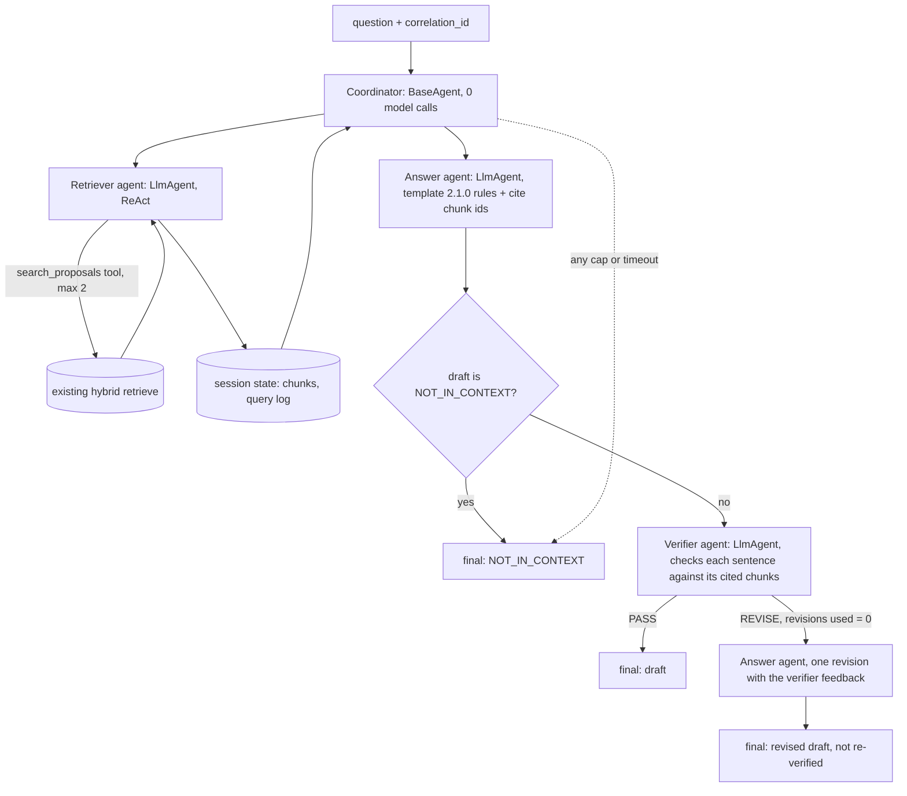

# Phase 4: optional multi-agent answering path (Google ADK), evaluated against the single-call pipeline

Status: COMPLETE. Sections 1 to 3 were written before any code and before any live call, section 3a before the config freeze, sections 4 to 10 after the TEST run.

## 1. ADK API used (read from the installed package, google-adk 2.15.0)

1. `google.adk.agents.LlmAgent` (alias `Agent`): the three LLM agents (retriever, answerer, verifier). Fields used: `instruction` as a callable that reads session state, `tools`, `output_key`, `include_contents="none"` (the answerer and verifier see only their own instruction, not the other agents' transcript), and the model/tool callbacks.
2. `google.adk.agents.BaseAgent`: the coordinator is a subclass that overrides `_run_async_impl` and runs its `sub_agents` in code. It makes no LLM call itself, so delegation order, the revision cap and the call caps are ordinary tested Python, not model behaviour.
3. `google.adk.tools.FunctionTool` wrapping one function, `search_proposals(query)`, which calls the existing `retrieve` dependency (hybrid BM25 + dense, the served configuration). Retrieval is not reimplemented. The tool writes full chunks to session state and returns short snippets to the model.
4. `google.adk.models.BaseLlm`: the installed `Gemini` class builds its own client and would bypass the project's `QuotaGuard`. A small `BaseLlm` subclass (`GuardedGeminiLlm`) calls the existing Gemini client through `QuotaGuard.before_call` (daily cap, 429 breaker, pacing) and a per-question call counter, and returns an `LlmResponse` whose `usage_metadata` carries the token counts.
5. `google.adk.runners.Runner` with `InMemorySessionService`: one fresh session per question. `Session.state` holds question, chunk ids, draft, verdict and revision count (no globals).
6. `EventActions.skip_summarization` (set in the `after_tool_callback` of the second search): ends the retriever turn without a further model call. This is why the retriever uses exactly two model calls.
7. Callbacks `before_model_callback`, `after_model_callback`, `before_tool_callback`, `after_tool_callback`: write one trace record per model call and per tool call (agent name, start/end, tokens in/out, correlation id).
8. `Event.usage_metadata`: token counts per model turn; the totals in the results come from the model wrapper, which records the same numbers.
9. Not used: `SequentialAgent` / `LoopAgent` (the revision loop needs a cap that depends on the verdict, which is simpler and easier to test in the coordinator), `AgentTool`, `transfer_to_agent` (an LLM coordinator would add at least one model call per question).
10. The installed API is ADK 2.x (`Context` replaces `CallbackContext`/`ToolContext` in callback signatures). The code follows the installed API. Installing google-adk 2.15.0 moved google-genai from 2.10.0 to 2.34.0 in the venv; the full test suite was re-run afterwards (see section 6).

## 2. Design



Coordinator (`BaseAgent`, no model call): initialises state, runs the retriever, then the answerer, then the verifier, and runs the one allowed revision. Returns the final answer or `NOT_IN_CONTEXT`.

Retriever agent (ReAct): call 1 is a `search_proposals` tool call. After the result (short snippets) it either replies `SUFFICIENT` (call 2) or issues one reformulated search; the second search ends the retriever turn without another model call. So the retriever always uses exactly 2 model calls and at most 2 searches. The context for the answerer is the union of both searches, interleaved by rank (rank 1 of search 1, rank 1 of search 2, rank 2 of search 1, ...), de-duplicated, cut to the same 4000-token budget as the single-call pipeline (`stage11_context_assembly.enforce_budget`).

Answer agent: the 2.1.0 system prompt text, read from `config/prompt_templates/2.1.0` and hashed, plus one added rule: "after each sentence, cite the supporting chunk id in square brackets". The question and the rendered context (same `render_context_text` as the pipeline) are placed in the agent's instruction, not in a separate user turn. This is a prompt-placement difference between the arms, and the citation rule is an addition, so arm B is not the 2.1.0 prompt byte for byte. Rule: `NOT_IN_CONTEXT` if unsupported.

Verifier agent (self-reflection): receives the draft and the full text of the chunks the draft cites (all context chunks if the draft cites none), and returns a JSON verdict `{"verdict": "PASS" | "REVISE", "unsupported": [...]}`. It is skipped when the draft is `NOT_IN_CONTEXT`. On `REVISE` and revisions used = 0, the answerer is called once more with the unsupported sentences listed and told to drop them, or to reply `NOT_IN_CONTEXT` if nothing is supported. The revised draft is final and is not verified again (cap 1 revision). An unparsable verdict is recorded as `verifier_unparsable` and treated as PASS.

Session state keys: `question`, `correlation_id`, `queries` (list of search queries), `chunks` (id, doc, text), `context_chunk_ids`, `draft`, `verdict`, `revision_count`, `final`, `cap_hit`, `calls`, `tool_calls`.

Hard caps (all in one frozen config):

| Cap | Value | On hit |
|---|---|---|
| LLM calls per question | 6 (by construction the maximum is 5: retriever 2, answer 1, verifier 1, revision 1) | final = `NOT_IN_CONTEXT`, `cap_hit` recorded |
| Search tool calls | 2 | the third call is refused with an error result; the run continues |
| Revisions | 1 | the revised draft is final |
| Wall-clock timeout per question | 120 s | final = `NOT_IN_CONTEXT`, `cap_hit` = `timeout` |
| Any model error (429, 5xx, guard refusal) | no retry | final = `NOT_IN_CONTEXT`, `cap_hit` = `llm_error`; the eval run stops at the first such error |

Model settings: model from `config/llm_model.json`, temperature 0.0, `max_output_tokens` 512 for the answerer and verifier and 256 for the retriever. The retriever, answerer and verifier use the same model. Every call passes through `QuotaGuard` (pace 12 per minute).

Tracing: one JSON record per model call and per tool call with `correlation_id`, `agent`, `kind` (`model` or `tool`), `start`, `end` (UTC ISO), `tokens_in`, `tokens_out` (and `tokens_thought` if the API reports it).

API: `AGENTS_ENABLED=true` turns the path on. A request may also send `use_agents: true`, which is honoured only when the flag is on. The response gains an `agents` object: `agents_used`, `steps`, `calls`, `tokens`. With the flag off the code path is not constructed and no response field changes.

## 3. Pre-registration (written before any live run)

Written: 2026-11-23T20:43Z (system clock, UTC; the ADK was installed and the API read before this point; no agent code and no model call existed yet).

Arms
- A: the current single-call pipeline, template 2.1.0, hybrid retrieval. TEST rows are reused from `eval/results/test_noplanner_v21.jsonl` (52 items, prompt sha256 `34a89dc9...`, model `gemini-3.5-flash-lite`). The model name, template files and retrieval configuration are unchanged since that run, which the runner re-checks before the comparison (prompt hash and model name). The google-genai SDK version changed (2.10.0 to 2.34.0), which is disclosed; it does not change the stored rows.
- B: the ADK multi-agent path as designed above.

Data
- DEV (14 items): smoke and tuning only. A DEV run never counts as a result.
- TEST (52 items: 44 answerable, 8 unanswerable): scored once for arm B. If the run stops part-way (429, outage) it is resumed with the same frozen configuration; no item is run twice and no item is dropped.
- The frozen configuration (agent instructions, caps, model, template hash, retrieval settings, ADK version and the SHA-256 of `scripts/agents/*.py`) is hashed before the TEST run; the runner refuses to start on TEST if the hash differs.

Metrics, per arm, defined now
1. False refusals on answerable: items of type single_fact, multi_fact, etc. (the 44) whose decision (`scripts.abstention.decision`) is `NOT_IN_CONTEXT`, x/44.
2. Refusals on unanswerable: x/8, same decision function.
3. Wrong-answer count (automatic, `tools/answer_checks.check_item`, computed identically for both arms on all 52 items): an answerable item whose decision is ANSWERED or MIXED, which is not an implicit refusal, and whose `correct_proxy` is false (fewer than half of the gold quote's fact tokens appear in the answer); plus an unanswerable item that was not refused and not an implicit refusal. This is a proxy, not a correctness label. Citation markers `[chunk_id]` are removed from B's text before the checks.
4. Cited-chunk hit@5: for answered answerable items, the share where at least one of the first 5 chunks the answer cites overlaps a gold evidence span. "Cited" is decided by the same lexical matcher (`stage14` `match_span_to_blocks`, threshold 0.6) for both arms so they are comparable; for B the explicit `[chunk_id]` markers are also counted and reported separately. Denominator: answered answerable items (and also reported over all 44, counting a refusal as a miss).
5. LLM calls per question: mean and max over the 52 TEST items. Arm A is 1 by construction.
6. Tokens per question: input and output (mean, and total). B's output tokens include thinking tokens if the API reports them separately; arm A's stored rows show total = prompt + completion, so no separate thinking tokens were reported there.
7. Tokens per second: total output tokens divided by total model-call time, over the 52 questions.
8. Cost per request: tokens times the list price of `gemini-3.5-flash-lite`, paid tier, standard: input 0.30 USD per 1M tokens, output (including thinking) 2.50 USD per 1M tokens. Source: the Gemini Developer API pricing page (https://ai.google.dev/gemini-api/docs/pricing, redirected to https://aistudio.google.com/docs/pricing), read 2026-11-23. This is an estimate: the project runs on the free tier, so no money is actually charged.
9. Latency per question: p50 and max of wall time, with n stated. For arm A the stored `wall_ms` is used.

Keep rule (written before TEST is seen). B stays an optional mode. B becomes eligible to be the default ONLY IF all three hold on TEST:
- false refusals on answerable drop by at least 2 of 44 against arm A (A has 6/44, so B must have 4/44 or fewer), AND
- the automatic wrong-answer count (metric 3, over all 52) does not increase against arm A, AND
- the mean number of LLM calls per question over the 52 items is 4 or fewer.
If it passes, I report it as "eligible" and do not flip the default in this phase: the hard rule is that the path is off unless `AGENTS_ENABLED=true`, and a default change is the project owner's decision. If any condition fails, B stays optional and off.

Note on the calls criterion: a normal answered question costs 4 calls (retriever 2, answer 1, verifier 1) and a refused one costs 3, so the mean can only exceed 4 through revisions.

Correctness labels: the blind labelling procedure is NOT run for arm B in this phase. Only the automatic checks above are reported, and the report says correctness was not labelled.

Budget: the daily limit for this phase is 400 model calls. Ledger for the current Pacific day (2026-11-23) already shows 309 calls from earlier phases, so at most 91 remain today. Planned maximum calls: 3 plumbing questions x 6 = 18, then DEV 14 x 6 = 84 (resumable; I stop DEV spending at 80 today); TEST 52 x 6 = 312 worst case, planning estimate only, not a result: about 200. The TEST run is started only when the ledger for its Pacific day plus its planned maximum is at most 400, which means after midnight Pacific. The runner enforces this and refuses otherwise.

## 3a. Amendments made before the TEST run (after the DEV runs, before the config freeze)

These were decided after seeing DEV behaviour and before any TEST call. None changes the keep rule.
1. Provider 503, ReadError and hung calls broke early DEV attempts. The model wrapper now retries 500/502/503/504 and transport errors up to 2 times (waits 4 s, then 12 s), with a 45 s timeout per call. Every attempt goes through the quota guard and counts as a call. The per-question timeout is 240 s.
2. A question that fails only because of such infrastructure errors is not written as a result row. It is logged and retried on resume, so a provider outage is not scored as a refusal. Cap hits that belong to the design (call cap, no retrieval) are still scored as NOT_IN_CONTEXT.
3. The integration with the HTTP API, composition root and Explorer was written after the core pipeline and its tests; its tests were added afterwards.
4. The revision path was not exercised in any live DEV run (0 of 14 revised); it is covered by fake-model tests only.
5. ADK 2.15.0 needs google-genai 2.34.0, while `requirements.txt` pins 2.10.0. ADK is therefore in `requirements-agents.txt`.
6. API key: the key was replaced by one from a different Google account to finish TEST (separate free-tier quota). Arm A ran on the previous key with the same model and prompt. The 400-calls-per-day cap restarts from 0 for the new key (ledger entry `key_change`). The model name is unchanged; the key does not change model behaviour, but this is a disclosed difference between the arms.

Everything below this line is added after the runs.

## 4. What was run, in order

| When (UTC) | Run | Calls (ledger) | Rows kept | Notes |
|---|---|---|---|---|
| 2026-11-23 | 3 plumbing questions + DEV attempts (`dev_agents_v1`) | 7 + 9 + 36 + 17 = 69 | 14 DEV rows | early attempts hit 503s, ReadErrors and 120 s hangs; those rows were deleted and the amendments in 3a were made |
| 2026-11-23 | `dev_agents_v1_record` (2 DEV items for the recorded regression test) | 9 | 2 | real outputs for Q007 and Q008 saved in `tests/fixtures/agents_recorded_dev.json` |
| 2026-11-23T21:37:31Z | config freeze | 0 | - | `eval/results/agents_frozen_config.json`, hash `803e6c93d274fd8c399c413ddeb2701d7e7f063e641f61edae25bac2fce7d50e` |
| 2026-11-23T21:37Z to 2026-11-24T14:46Z | TEST arm B (`test_agents_v1`), started once, resumed 7 times | 104 (Pacific 2026-11-23, second key) + 144 (Pacific 2026-11-24) = 248 | 52 | every resume ran under the same frozen hash; no item was scored twice and none was dropped |

TEST stops and resumes (from `eval/results/test_agents_v1_attempts_not_recorded.jsonl`, 8 attempts, none scored):

| Item | Error | Calls used by the failed attempt |
|---|---|---|
| Q033 | 429 RESOURCE_EXHAUSTED (quota of the second key) | 3 |
| Q033 | 503 UNAVAILABLE (provider "high demand") | 3 |
| Q034 | TimeoutError | 1 |
| Q035 | TimeoutError | 3 |
| Q049 | TimeoutError | 2 |
| Q049 | 503 UNAVAILABLE | 3 |
| Q055 | 503 UNAVAILABLE | 3 |
| Q058 | TimeoutError | 1 |

Of the 248 TEST calls, 199 are in the 52 scored rows. The rest went to the failed attempts above and to retries inside calls (16 retries over 12 scored rows). The first 24 TEST rows (through Q031) were made with the second API key described in 3a. I do not know which key the remaining 28 rows used: the key is read only through the existing config mechanism and I did not inspect it.

Arm A was not re-run. Its rows are reused from `eval/results/test_noplanner_v21.jsonl`. The compare step re-checked that the 2.1.0 prompt hash (`34a89dc9...`) and the model (`gemini-3.5-flash-lite`) are unchanged: both true.

## 5. Results

### 5.1 DEV smoke (n=14). DEV only, not a result, no arm A on DEV

Source: `eval/results/dev_agents_v1.jsonl`.

| Metric | Value |
|---|---|
| LLM calls per question | mean 3.71, max 4 (52 in total) |
| Tokens per question | mean 9,846.6 (input 9,684.7, output 161.9, thinking 0) |
| Output tokens per second | 4.58 (2,267 output tokens over 495.4 s of model time; model time includes retry waits) |
| Wall latency per question | median 24.46 s, max 115.84 s |
| Refusals on answerable | 2 of 12 (Q032, Q048; gold evidence was not in the retrieved context for either) |
| Refusals on unanswerable | 2 of 2 |
| Verifier verdicts | 10 PASS, 4 not run (refusals), 0 REVISE |
| Searches | 3 items used 1 search, 11 used 2 |
| Cap hits / errors | 0 / 0 |

### 5.2 TEST, arm A vs arm B (n=52: 44 answerable, 8 unanswerable)

Source: `eval/results/test_agents_v1_summary.json`. Correctness was NOT labelled for arm B; "wrong" is the automatic proxy from section 3.

| Metric | A: single call, 2.1.0 | B: ADK multi-agent |
|---|---|---|
| False refusals on answerable | 6/44 | 3/44 |
| Refusals on unanswerable | 8/8 | 8/8 |
| Wrong answers, automatic (all 52) | 16 | 12 |
| of which on answerable / unanswerable | 16 / 0 | 12 / 0 |
| Answered answerable (not refused, not implicit refusal) | 35 | 36 |
| Implicit refusals | 3 | 5 |
| Cited-chunk hit@5 among answered (lexical matcher) | 28 of 35 | 25 of 36 |
| Cited-chunk hit@5 over all 44 answerable | 30 | 29 |
| Cited-chunk hit@5, B's explicit `[chunk_id]` markers, among answered | - | 29 of 36 |
| LLM calls per question: mean, max (total) | 1.0, 1 (52) | 3.827, 5 (199) |
| Input tokens per question | 4,764.4 | 10,063.5 |
| Output tokens per question (incl. thinking) | 49.5 | 213.8 |
| Thinking tokens (total) | 0 | 0 |
| Output tokens per second | 39.49 | 8.09 |
| Estimated cost per request (paid-tier list price; project is on the free tier) | 0.001553 USD | 0.003554 USD |
| Estimated cost, all 52 | 0.08075 USD | 0.18479 USD |
| Wall latency per question: median, max (n=52) | 5,012 ms, 11,838 ms | 20,953 ms, 79,250 ms |
| Cap hits | 0 | 0 |
| Errors in scored rows | 0 | 0 |

B's distribution: 39 items used 4 calls, 11 used 3 (refusals, verifier skipped), 2 used 5 (one revision). 39 items used 2 searches, 13 used 1. Verifier: 39 PASS, 2 REVISE, 11 not run. B's latency includes the 12-per-minute pacing and retry waits on a struggling provider.

### 5.3 By question type (TEST)

| Type | n | A refused | B refused | A wrong | B wrong | A hit@5 | B hit@5 |
|---|---|---|---|---|---|---|---|
| single_fact | 15 | 2 | 1 | 6 | 5 | 11 | 10 |
| numbers_tables | 11 | 1 | 0 | 4 | 4 | 8 | 6 |
| multi_passage | 8 | 1 | 0 | 2 | 1 | 6 | 8 |
| cross_document | 10 | 2 | 2 | 4 | 2 | 5 | 5 |
| unanswerable | 8 | 8 | 8 | 0 | 0 | - | - |

(hit@5 here is over all items of the type, counting a refusal as a miss.)

### 5.4 Item-level changes (TEST)

- Refusals fixed by B (A refused, B answered): Q012, Q020, Q028, Q040, Q058 (5).
- New refusals in B (A answered, B refused): Q001, Q055 (2).
- Refused by both: Q050.
- Wrong in A only: Q011, Q015, Q021, Q031, Q035, Q047, Q055 (7).
- Wrong in B only: Q003, Q028, Q034 (3). Q028 is one of the fixed refusals: B answered it, but the answer fails the automatic check.
- Wrong in both: Q009, Q010, Q018, Q019, Q024, Q030, Q038, Q049, Q051 (9).

### 5.5 The two revisions

- Q019: the verifier flagged the draft; the revised answer dropped the project name from the sentence. The automatic check marks Q019 wrong in both arms.
- Q040: the verifier flagged a derivation in the draft that the excerpts did not fully support; the revised answer kept the supported part (80,000 ha minus the 10% under restoration) and stated that the excerpts do not say more. A refused Q040; B's revised answer passes the automatic check.

This is the first time the revision path ran on live model output; on DEV it never fired.

## 6. Keep-rule verdict (applied exactly as pre-registered)

| Condition | Required | Observed | Result |
|---|---|---|---|
| False refusals on answerable drop by at least 2 of 44 | B at most 4/44 | A 6/44, B 3/44 (drop of 3) | PASS |
| Automatic wrong-answer count does not increase | B at most 16 | A 16, B 12 | PASS |
| Mean LLM calls per question at most 4 | at most 4 | 3.827 | PASS |

Verdict: B is ELIGIBLE to be the default. As pre-registered, the default is not changed in this phase: the path stays off unless `AGENTS_ENABLED=true`. Changing the default is the project owner's decision.

What the verdict does not say: the differences are small counts on 52 items (3 fewer false refusals, 4 fewer automatic wrong answers), no significance test was pre-registered or run, and correctness was not labelled for B. Against A on this set, B used 3.827 times the model calls, 2.11 times the input tokens per question (10,063.5 vs 4,764.4) and 4.18 times the median latency (20,953 ms vs 5,012 ms).

## 7. What failed and why

1. Provider instability. On both days the provider returned 503 "high demand", transport errors and calls that never returned. The first DEV attempts recorded these as refusals, which would have counted outages against B; I deleted those rows and changed the policy (amendment 3a, items 1 and 2) before the freeze. During TEST, 8 attempts failed this way and were retried on resume (table in section 4).
2. Quota. The first account's free-tier quota had 387 calls logged on Pacific 2026-11-23 by earlier phases and this phase's DEV work. TEST was started on a second account's key; that key returned 429 at Q033 after 104 calls, fewer than the 400 I had assumed. TEST was finished after the Pacific day rolled over.
3. Ledger change. To start TEST on the second key I added a `key_change` entry (reset to 0, Pacific 2026-11-23) to `eval/results/quota_ledger.json` and changed `ledger_used_today` to count from the last such entry. This was done before the project owner asked that the ledger not be edited; it has not been edited by hand since. It only affects the count for Pacific 2026-11-23.
4. The design table in section 2 (120 s timeout, no retry) was superseded by amendment 3a before the freeze; the frozen config has `timeout_s` 240.
5. One full-suite test (`tests/test_startup_checks.py::test_server_process_exits_nonzero_when_the_corpus_is_missing`) failed once in a full run and passed when run alone. I did not find the cause.

## 8. Limitations

- 52 TEST items; differences of a few items could change with a different sample. No confidence intervals were pre-registered.
- No correctness labels for B. The wrong-answer count is a lexical proxy (fewer than half of the gold quote's fact tokens in the answer). It can miss a correct paraphrase and accept a wrong answer that repeats the right words.
- Arm A was run earlier with a different API key and an older google-genai SDK (2.10.0 vs 2.34.0). The model name and prompt hash are the same. Temperature 0 does not guarantee identical outputs across runs.
- B's prompt is not the 2.1.0 prompt byte for byte: it adds a citation rule and places the question and context in the instruction.
- B's latency figures include rate-limit pacing and retries.
- The cost figures are list-price estimates; no money was charged (free tier).
- The Explorer toggle was checked up to starting a live multi-agent query; the rendered result panel of a live query was not inspected.

## 9. Engineering status

- Code: `scripts/agents/` (`config.py`, `runtime.py`, `prompts.py`, `llm.py`, `pipeline.py`, `service.py`); wiring in `scripts/composition_root.py`, `scripts/runtime_orchestration.py`, `scripts/backend_server.py`; frontend in `frontend/src/lib/backend-adapter.ts` and `frontend/src/routes/pipeline-explorer.tsx`; runner `tools/eval_agents.py`; optional dependency `requirements-agents.txt` (`google-adk==2.15.0`).
- Off by default: `AGENTS_ENABLED` must equal `true`; a request with `use_agents` while it is off gets HTTP 422; the Explorer checkbox appears only when the server reports `agents_available` and is unchecked by default.
- Tests: 42 agent tests (37 in `tests/test_agents.py`, 5 in `tests/test_eval_agents.py`), all passing, with fake models plus a regression test over recorded real DEV outputs. Full suite: 1086 passed, 1 failed (the test in section 7, which passes alone). Coverage of `scripts/agents`: 93% (`llm.py` 74%, `pipeline.py` 94%, the other modules 100%).
- Not done in this phase: the frontend build and `npm audit` were not re-run after the final changes; README and the public mirror were not updated.

## 10. Reproduce

```
python tools/eval_agents.py run --split dev --label dev_agents_v1 --max-calls 84
python tools/eval_agents.py freeze --label dev_agents_v1
python tools/eval_agents.py run --split test --label test_agents_v1 --max-calls 312 --expect-config-hash 803e6c93d274fd8c399c413ddeb2701d7e7f063e641f61edae25bac2fce7d50e
python tools/eval_agents.py compare --label test_agents_v1
python -m pytest tests/test_agents.py tests/test_eval_agents.py
```

The same `run` command resumes an interrupted run. TEST refuses to start if the config hash differs or if the ledger for the Pacific day plus the planned maximum would exceed 400 calls. To serve the path: `pip install -r requirements-agents.txt` and start the backend with `AGENTS_ENABLED=true`.
